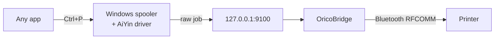

<div align="center">

# OricoBridge

**Print to Bluetooth printers from any Windows app. Just <kbd>Ctrl</kbd> + <kbd>P</kbd>.**

Orico A41 · PeriPage A40 · Deli X8 · PikDik PD-A4 · Jadens · other PeriPage-protocol printers


[Download](../../releases/latest) · [Supported printers](#supported-printers) · [How it works](#how-it-works) · [Settings](#settings)

</div>

---

These printers come with a phone app and nothing for Windows. Pair one over Bluetooth and the print spooler waits on its COM port; send a page directly and the small buffer fills up a few centimeters in.

OricoBridge fixes that. Windows sends to a port with the manufacturer's signed driver, and a small background program sends the page to the printer at a pace it can handle.

> [!TIP]
> No Python, no Visual C++ runtime, no console window. One 220 KB exe that starts with Windows and stays under 0.3 MB of RAM and zero CPU.

## Install

1. Turn the printer on. Pair it: **Settings → Bluetooth & devices → Add device**.
2. [Download the installer](../../releases/latest) and extract it.
3. Right-click **`Install.bat`** → **Run as administrator**.
4. Choose your printer and its type. The correct options are already selected, so press <kbd>Enter</kbd>, <kbd>Enter</kbd>.
5. Print.

```text
Paired Bluetooth devices:
  1. A41_1A2B  (AA:BB:CC:DD:1A:2B)  <- printer
  2. AirPods   (AA:BB:CC:DD:EE:FF)
  0. Not in the list: I'll pair it now, then refresh

Which one is your printer? [1]:
```

`Uninstall.bat` removes everything again.

<details>
<summary><b>Silent / scripted install</b></summary>

```powershell
setup.ps1 -Yes        # take the suggestions, ask nothing
setup.ps1 -DryRun     # show what would be installed, change nothing
setup.ps1 -Mac AA:BB:CC:DD:1A:2B -Model A4Lpro -PrinterName "PeriPage A40+"
```

`-Model`: `A4L` (default) · `A4Lpro` · `A40s` · `A8` · `A9` · `B21` · `MC220`

</details>

## Supported printers

| Printer | Type | Status |
| --- | --- | --- |
| Orico A41 | A4, 203 dpi | Tested |
| AiYin A4L · PeriPage A40 / A40a / A40e / P40 / P80 · Deli X8 / GE223 · PikDik PD-A4 · Jadens JD-116 / 126 / 136 / 156 · FICHERO 6181 · SQAI PP G40 | A4, 203 dpi | Should work |
| AiYin A4L Pro · PeriPage A40+ / A40 Pro / P40 HD / P80 HD · Deli X8 Pro / AZ5005 · PikDik PD-A4 Pro | A4, 300 dpi | Should work |
| AiYin A40s | A4 stencil | Should work |
| AiYin A8 · A9 · B21 · MC220 | A4 / 48 mm labels | Should work |

*Should work* means the AiYin driver treats the model as a version of a tested printer and sends it the same data, but nobody has tried it with OricoBridge yet.

> [!NOTE]
> Something doesn't print, or you got a *should work* printer running? Please [open an issue](../../issues). Add the printer model, its Bluetooth name and the last lines of `C:\ProgramData\OricoBridge\OricoBridge.log`.

<details>
<summary><b>Not supported</b></summary>

- Narrow PeriPage models (A6, A8 / A9 with 57–107 mm paper, Q7…): the driver package has no Windows driver for them.
- Printers that speak TSPL, CPCL or plain ESC/POS.

</details>

## How it works



The driver creates each page as one `GS v 0` raster image, about 474 KB for A4. The printer can hold maybe 16–32 KB, and it never says "wait". So the bridge:

- divides the page into 64-row blocks;
- keeps to **24 000 bytes/s** and **120 rows/s**, whichever is slower (an A4 page takes about 30 s);
- sets density to maximum once per connection;
- feeds 40 mm of paper after each page.

The installer also changes the driver from dithering to threshold, so text prints solid black instead of grainy.

<details>
<summary><b>Lessons learned the hard way</b></summary>

- The PeriPage wake-up command `10 FF FE 01` also resets density and stops the paper motor. Send it before every chunk and you get faint, torn text. Once per connection is enough.
- `SOCKADDR_BTH` must be `#[repr(C, packed)]`, 30 bytes. Without `packed` it grows to 40 on x64, and `connect()` fails with `WSAEADDRNOTAVAIL`.
- The driver's dithering turns Windows font smoothing into a dot pattern on 203 dpi paper. Threshold mode fixes it.

</details>

## Settings

Nothing to configure normally. The installer sets the printer address for you.

<details>
<summary><b><code>OricoBridge.ini</code> reference</b></summary>

Place it next to the exe (`C:\ProgramData\OricoBridge\`) and restart the bridge.

| Key | Default | |
| --- | --- | --- |
| `mac` | auto | Printer Bluetooth address |
| `channel` | `1` | RFCOMM channel, `auto` asks the printer via SDP |
| `density` | `2` | `0`–`2`, 2 is darkest |
| `rate` | `24000` | Max bytes per second |
| `rows_per_sec` | `120` | Max rows per second |
| `chunk_rows` | `64` | Rows per raster block |
| `feed_dots` | `320` | Feed after each page (40 mm), `0` for labels |
| `dump` | `0` | `1` saves every job to `jobs\` for debugging |

The same keys work as arguments: `OricoBridge.exe --density 1 --rate 20000`.

</details>

## Building

```sh
cargo test
cargo build --release
```

Needs Rust with the MSVC toolchain. The C runtime is linked statically (`.cargo/config.toml`), so the exe runs on a clean Windows. The AiYin driver files that go into the installer are not part of this repository.

---

<sub>MIT licensed. Not affiliated with Orico, PeriPage, AiYin or any other brand mentioned; names are used only to describe compatibility.</sub>
